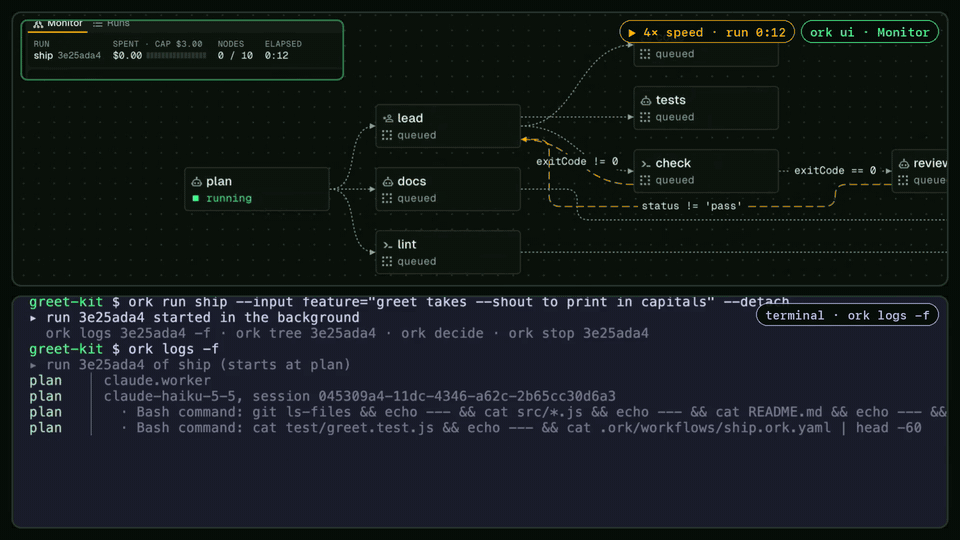

<p align="center"></p>

# Ork

**An orchestration harness for Claude agents that runs on your machine.**

<p align="center"></p>

Ork lets you design workflows of agent and tool nodes, save them as plain YAML
next to your code, and run them locally with your own accounts. Think n8n, but
for agents and engineering tasks:

- **Hierarchical.** A leader hands each child only the brief it needs, gets a
  short report back, and has the child's branch merged into its own.
- **Isolated.** Every writing agent works in its own git worktree and branch, so
  your checkout stays as it was unless you ask a step to work there. Ork never
  pushes on its own.
- **Context-engineered.** Fresh sessions per task, briefs instead of
  transcripts, cache-friendly prompts, a model and effort per node, budgets, and
  bounded loops.
- **Yours.** Your repository's `CLAUDE.md`, `AGENTS.md` and skills load as they
  do in Claude Code, and Ork never stores a credential.

> **Alpha.** Ork works today, from the terminal and in the browser (`ork ui`),
> but the workflow format and commands can still change until 1.0.0. What
> changed lately: [What's new](./docs/whats-new.md).

## Get started

Two ways in:

- **Set it up yourself:**
  [Installation](./docs/getting-started/installation.md), then the
  [Quickstart](./docs/getting-started/quickstart.md). The short version is
  below.
- **Have your agent do it:**
  [With your agent](./docs/getting-started/with-your-agent.md): Claude Code (or
  any MCP client) installs Ork, sets up your project and writes a first
  workflow, asking you before each change.

You need Node 24.20+, git, and one agent driver: your own `claude` login, or an
API key, Bedrock, Vertex or Foundry. (`opencode` and Command Code's `cmd` are
built too, but unproven and refused until a real session has run on them; see
[Drivers](./docs/guides/drivers.md).) `gh` and `aws` are optional, needed only
by workflows that use them. Run Ork inside a git repository with at least one
commit:

```sh
npm install --global @krapht/ork
ork doctor                                   # checks Node, git, your agent logins
ork init                                     # a starter workflow in .ork/workflows/
ork validate                                 # checks the workflow
ork run hello --input task="add a README"    # leader, worker, then your approval
ork worktrees                                # the branches it left
ork worktrees clean                          # removes the merged ones; asks first
ork ui                                       # your runs in the browser
```

## Documentation

- **Guides:** everything else, from writing workflows to the browser view, is in
  the [documentation center](./docs/README.md). New to the ideas? Start with
  [How Ork works](./docs/how-ork-works.md).
- **Benchmarks:** [Ork building Ork](./benchmarks/README.md): what real features
  cost and how long they took, against a plain Claude Code session.
- **Reference:** the [specs](./specs/README.md) and the
  [JSON Schema](./packages/schema/workflow.schema.json).
- **Contributors:** the [design overview](./specs/design.md), the
  [interaction map](./docs/interaction-map/README.md) and its
  [roadmap](./docs/interaction-map/roadmap.md);
  [decisions (ADRs)](./decisions/README.md) and
  [proposals (RFCs)](./rfcs/README.md); [ONBOARDING.md](./ONBOARDING.md) for how
  to read the project, [CONTRIBUTING.md](./CONTRIBUTING.md), the
  [Code of Conduct](./CODE_OF_CONDUCT.md), and the
  [runbook](./runbook/development/release.md). Report vulnerabilities as
  [SECURITY.md](./SECURITY.md) describes.

Full example workflows, such as `software-factory` and `pr-review`, are in
[the examples guide](./docs/guides/examples.md).

## License

[MIT](./LICENSE). Third-party notices:
[THIRD_PARTY_NOTICES.md](./THIRD_PARTY_NOTICES.md).
