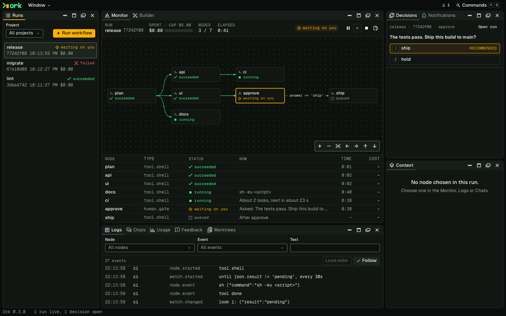

# The browser view

`ork ui` shows your runs in your browser: what is happening, what is waiting on
you, and what each node has said. It reads and writes the same store as the
`ork` command, so a run started in one shows up in the other, and every action
here has a command that does the same. The contract is the
[UI spec](../../specs/ui.md).

## Contents

- [Starting it, and what you can do](./browser-view/starting-and-commands.md)
  - [Starting it](./browser-view/starting-and-commands.md#starting-it)
  - [What you can do, and the command for it](./browser-view/starting-and-commands.md#what-you-can-do-and-the-command-for-it)
- [The panels and the workspace](./browser-view/panels-and-workspace.md)
  - [The panels](./browser-view/panels-and-workspace.md#the-panels)
    - [Builder](./browser-view/panels-and-workspace.md#builder)
  - [The workspace](./browser-view/panels-and-workspace.md#the-workspace)
- [Keys, accessibility, and what it does not do yet](./browser-view/keys-and-accessibility.md)
  - [Keys](./browser-view/keys-and-accessibility.md#keys)
  - [Accessibility](./browser-view/keys-and-accessibility.md#accessibility)
  - [What it does not do yet](./browser-view/keys-and-accessibility.md#what-it-does-not-do-yet)
- [New versions](./browser-view/new-versions.md)

## Next

[Running workflows](./running-workflows.md): the same runs from the terminal.
