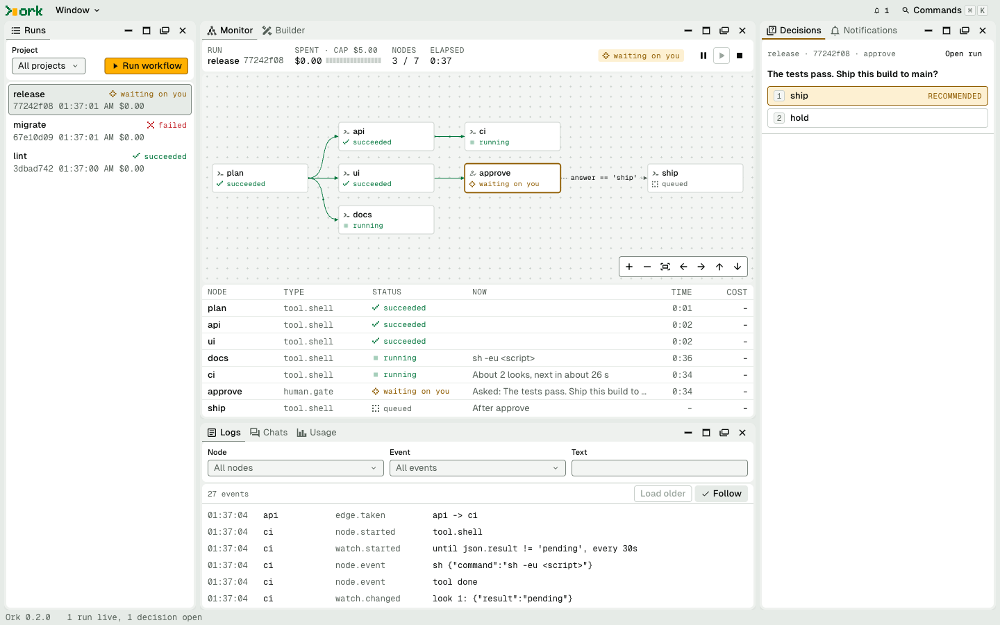

# The panels and the workspace

_Part of [The browser view](../browser-view.md)._

## The panels

**Runs** lists the newest 50 runs, filtered by project if you choose one, with
each one's status and cost. Choosing a run opens it in the other panels. **Run
workflow** asks for a project, a workflow and its inputs, shows the command as
you fill them in, and says why it cannot start yet. Once started, the focus goes
to the new run in the Monitor. If your projects have
[triggers](../watching.md#starting-a-run-when-something-happens), they're listed
under the runs, with whether each is live. Accepting one takes a terminal.

**Monitor** draws the run as it goes, beside the same nodes as a tree. Each node
shows its status, cost, tokens and model. A node that
[runs once per item](../writing-workflows/running-per-item.md) is one card, and
its status line says how far it is, such as `3 of 8, 1 failed`; its items are
rows under it in the tree, `build.0` to `build.7`, and open and close with the
node. Select an item for its own controls and logs. Select a node for its own
controls. Stopping asks first and says what will happen: a stopped node fails,
and the workflow's failure rules apply; a stopped run can be resumed.
**Resume…**, on a run that stopped, failed or crashed, asks first, shows the
`ork resume` command it stands for, and picks the run up where it left off, in
the background. A node that called another workflow links to that run, and one
that's [watching a source](../watching.md) says what it's waiting for and how
often it looks. **Note…** on a node, or among the run's controls, adds your
[feedback](../feedback.md) on how it went.

**Logs** shows a run's events. It stays on the newest; scroll up and it holds
still, and **Follow** counts what is new. Filter by node (`build` keeps `build`
and its items; `build.2` keeps one), by event type or by text. Filters look
through what is loaded, and **Load older** reads more. Open a row for the whole
event.

**Decisions** collects every open question from every run. Answer with one
click, or with the focus in a card press `1` to `9`, or `Enter` on the card for
the recommended option. To send words with your answer, type them in the card's
**Note for the run** box first, then choose; keys typed in the box stay in it,
so `Enter` there starts a new line rather than answering. A card stays until the
run has taken the answer, and if it is refused it says why. Below, **Settled**
says who answered what, including from a terminal, and what they said.

A decision reads as Markdown, never as raw HTML. A code block has a copy button,
and text past about 20 lines folds behind **Show all**. **Read document** opens
what a gate gave to read in a dialog of its own; `Escape` closes it and you are
back on the same card. When decisions come from more than one run, **Workflow**
and **Run** filters appear, each choice with its count, and a line says how many
the filter hides; only the panel is filtered, and the filters stay as you left
them in this browser. In the Monitor, a run with open decisions shows **N
decisions waiting**, which opens them filtered to that run. If `ork ui` stops
while you read, the answer buttons turn off and each option shows its
`ork decide` command.

**Chats** keeps one thread per leader or worker, with what it said, what you
said, and what it did in between. While the run is live, `Enter` sends and
`Shift+Enter` starts a new line. Once the run has ended, it gives you the
`ork chat` command, which picks that session up in your terminal.

**Notifications** lists open decisions and runs that ended, crashed or paused,
and the bell in the top bar counts what is unread. What you have read is kept
per browser. Desktop notifications are off until you turn them on here, which
makes your browser ask.

**Usage** shows what runs spent over a period, for a project or all of them:
totals, spend per day, and the costliest workflows, models and nodes, with what
is worth a look. See [what you spent](../models-and-budgets.md#what-you-spent).

**Context** shows what the node you chose last is told, and where each piece
comes from: its agent, the project's instructions, its skills (live, or off and
why), its context files, Ork's practices, and the whole prompt Ork appends, each
with its estimated size. Open a piece to read it exactly as the session does.
Choose a node in the Monitor, Logs or Chats, or select a card in the Builder,
where it follows your draft as you edit. A run's node is planned from your files
as they are now, so if one changed after the run started, it names it: what you
see may not be what the run loaded.

**Feedback** lists what got in your runs' way, from every project, filtered by
status and by what it's about. Choose an item to read its records, newest first,
then dismiss or restore it, accept it, make it a lesson for its workflow, have
Ork propose a fix, or share one about Ork. Each action shows what it will do
first ([feedback in the browser](../feedback.md#in-the-browser)).

**Worktrees** lists the worktrees and branches your runs left, for every project
at once. **Remove…** takes one away and **Clean merged…** tidies what's merged;
each shows its plan and its command, and asks, twice if work would be lost
([worktrees in the browser](../worktrees.md#in-the-browser)).

### Builder

Creates or edits a workflow, with no YAML to write. Choose a project, then a
workflow, or type a new name and choose **Create**.

- Add a node from the list on the left. The canvas arranges itself from the
  nodes and their edges, so there's nothing to drag.
- Select a card to fill it in on the right. With nothing selected, the same
  place has the workflow's own settings.
- To connect two nodes, select the first, then use **Connect to**, or **Pick a
  card** and choose the next one.
- An edge's condition is a choice: when it succeeds, when it fails, or when a
  test holds, picked as a field, a test and a value from what that node can say.
  A tool's JSON has choices once it declares them, and **Add a field** does that
  from the condition. A condition these can't show stays as you wrote it, under
  **Written by hand**.
- A node that can run once per item has a **For each** group. **Run this node**
  chooses once, once per item you list, or once per item of a list from an
  earlier node. **List from** offers only the lists earlier nodes declare,
  **Most items** caps it, and **Add a list** declares one on an earlier node
  ([running a node once per item](../writing-workflows/running-per-item.md)).
- A `watch:`'s **until** is chosen the same way, from what the node declares.
- A new edge starts valid. Closing a loop fills in a condition and a limit on
  rounds, and a gate's edge takes its next answer. Under a gate, it says which
  answers end the run.
- Renaming an option or a declared value follows into the conditions that read
  it. Removing one that's read is refused, and it names the edge to change
  first.
- What the checks say shows on the cards, on the fields and under the canvas.
  They're the same checks as `ork validate`, including its walk of every way
  through the workflow, and only an error stops you saving. On a very large
  workflow the walk may stop early here to keep editing quick, and it says so.
- What you change is kept as a draft, so closing the tab loses nothing, and your
  workflows folder only gets it when you choose **Save**, which needs no errors
  left. Save never commits.
- **Run…** saves and opens Run workflow. It's a real run: it can spend money,
  and commit work. Before it starts, it names the nodes that act outside the
  worktree.

The file it saves is the one you could write by hand. Lines you didn't edit stay
exactly as written, comments included. Cards have no saved positions, so a
`<name>.layout.json` from an older version is ignored and can be deleted.

## The workspace

Drag a tab to dock it beside or into another group, or use the buttons on each
group to minimize it to the rail, maximize it, float it or close it. The layout
is saved in your browser, and **Reset layout** in the palette brings the default
back. Below about 1024 px wide the panels stack, and each one folds.

The command palette, `⌘K` or `Ctrl K`, runs everything by name: going to a
panel, the theme, the density, starting a run, upgrading Ork. When a newer Ork
is out, a banner above the panels says so ([new versions](./new-versions.md)).

